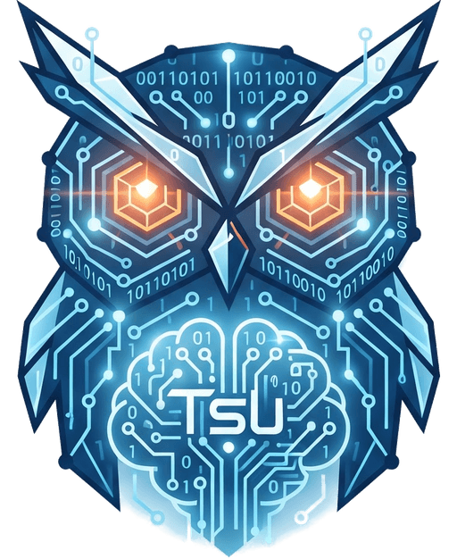

# tsudev-contact

Công cụ desktop chuyển danh bạ **CSV → vCard (.vcf)** để nạp vào điện thoại, chạy ngoại tuyến hoàn toàn trên máy của bạn.

Một sản phẩm của [tsudev](https://tsudev.com).

- Trang sản phẩm: <https://contact.tsudev.com>
- **Hạng sản phẩm: C** - công cụ cục bộ, không có tài khoản, không gửi dữ liệu đi đâu
  (`.standards/docs/AUTH_AND_ACCOUNT.md` mục 1).

## Tải bản cài đặt (người dùng cuối)

[**Trang phát hành → Releases**](https://github.com/tsudev-org/tsudev-contact/releases/latest)
→ tải `tsudev-contact_{version}_x64-setup.exe` trong mục *Assets*, bấm đúp để chạy.
File chạy độc lập, **không cần cài Python**. Lần đầu SmartScreen có thể cảnh báo (chưa có chứng
thư của CA - xem mục *Ký số bản .exe*): *More info → Run anyway*. Muốn chắc file không bị sửa,
đối chiếu với `SHA256SUMS.txt` đính kèm cùng bản phát hành:

```powershell
Get-FileHash tsudev-contact_26.8.2002_x64-setup.exe -Algorithm SHA256
```


## Tính năng

- **Kéo-thả tệp CSV**, tự nhận bảng mã (UTF-8, UTF-16, Windows-1258) và dấu phân cách (`,` `;` tab `|`).
- **Tự ghép cột** tiếng Việt/tiếng Anh/Google Contacts, xem giá trị mẫu của từng cột.
- **Kiểm tra từng dòng**: chuẩn hóa số điện thoại Việt Nam (`+84`, mất số 0 đầu do Excel, nhiều số
  trong một ô), email, ngày sinh; phát hiện **trùng số**; liên hệ lỗi không được xuất.
- **Xem trước** có lọc Hợp lệ / Cảnh báo / Lỗi, tìm không dấu, phân trang 10/20/50/100/200.
- **Xuất vCard 3.0** chuẩn RFC (Android, iPhone, Google Contacts) và **báo cáo lỗi** CSV để sửa dữ liệu.
- Giao diện Sáng / Ấm / Tối / Theo hệ thống; tiếng Việt (mặc định) và tiếng Anh.
- **Bảo mật**: chạy ngoại tuyến, không lưu danh bạ xuống đĩa, chống chèn vCard và chèn công thức.
  Chi tiết: [`docs/ARCHITECTURE.md`](docs/ARCHITECTURE.md) mục 5, báo lỗ hổng: [`SECURITY.md`](SECURITY.md).

## Chạy từ mã nguồn (lập trình viên)

Yêu cầu **Python 3.11+**.

```bash
python -m venv .venv && . .venv/bin/activate          # Windows: .venv\Scripts\activate
pip install --require-hashes --no-deps -r requirements.txt -r requirements-dev.txt
python contacts.pyw
```

## Chạy test

```bash
python -m pytest -q tests                                              # Linux/WSL: giao diện chạy offscreen
ruff check .
```

```powershell
powershell -ExecutionPolicy Bypass -File scripts\test-gui-win.ps1      # Windows, venv riêng
```

Dữ liệu mẫu (tên, số giả): `python tests/fixtures/make_samples.py <thư-mục>`.

## Phụ thuộc

Sửa `requirements.in` / `requirements-dev.in` rồi chạy `scripts/lock-deps.sh` để khóa lại kèm hash.
Không bao giờ `pip install` gói lẻ ngoài file khóa.

## Đóng gói Windows

```powershell
powershell -ExecutionPolicy Bypass -File scripts\build-win.ps1
```

Script cài phụ thuộc theo hash, chạy test, gọi PyInstaller, sinh SBOM CycloneDX và đặt sản phẩm vào `release/` với tên
theo `.standards/docs/VERSIONING.md` mục 2 (ví dụ `tsudev-contact_26.8.2002_x64-setup.exe`).
Tên file lấy từ `RELEASE_BASENAME` trong `src/app_info.py` - mỗi bản mới tăng 2 số cuối.

## Phát hành một bản mới

1. Sửa `APP_VERSION` trong `src/app_info.py` theo `{YY}.{M}.{DD}{NN}` (tăng `NN` nếu cùng ngày).
2. Ghi thay đổi vào `CHANGELOG.md`, commit.
3. `git tag v<APP_VERSION> && git push origin v<APP_VERSION>`.

Workflow `.github/workflows/build-release-win.yml` sẽ chạy trên `windows-latest`: cài phụ thuộc theo hash,
chạy test, đối chiếu tag với `APP_VERSION`, gọi `scripts/build-win.ps1`, ký **chứng thực nguồn gốc bản build**
và đính `.exe` + SBOM (`.cdx.json`) + `SHA256SUMS.txt` vào Release của tag đó. Người tải kiểm chứng:
`gh attestation verify <file>.exe --repo tsudev-org/tsudev-contact`.
Chỉ chạy khi có tag (không chạy mỗi lần push) - giữ thói quen tiết kiệm phút Actions.

> Repo để **public** nên Actions chạy miễn phí không giới hạn. Nếu vì lý do nào đó Actions không
> chạy, vẫn phát hành được bằng tay ngay trên máy Windows:
>
> ```powershell
> powershell -ExecutionPolicy Bypass -File scripts\build-win.ps1
> gh release create v26.8.2003 release\*.exe --title "tsudev-contact 26.8.2003 - Windows x64" --notes-file notes.md
> ```

## Ký số bản .exe (tùy chọn)

```powershell
powershell -ExecutionPolicy Bypass -File scripts\sign-win.ps1 -SelfSigned      # chứng thư tự ký
powershell -ExecutionPolicy Bypass -File scripts\sign-win.ps1 -PfxPath ma.pfx  # chứng thư của CA
powershell -ExecutionPolicy Bypass -File scripts\build-win.ps1 -Sign -SelfSigned
```

Script dùng công cụ có sẵn trong Windows (`Set-AuthenticodeSignature`) + máy chủ đóng dấu thời gian
miễn phí - **không tốn phí**. Nhưng nói thẳng: chứng thư **tự ký không gỡ được cảnh báo SmartScreen**
trên máy người khác; muốn hết cảnh báo phải mua chứng thư OV/EV của CA, không có phương án miễn phí
tương đương. Mật khẩu `.pfx` không truyền qua tham số - đặt `$env:SIGN_PFX_PASSWORD` hoặc để script hỏi.

Cách xác thực miễn phí đang dùng: mỗi Release kèm `SHA256SUMS.txt`, người tải đối chiếu bằng
`Get-FileHash <file> -Algorithm SHA256` (Windows) hoặc `sha256sum -c SHA256SUMS.txt` (Linux/macOS).

## Lưu ý dữ liệu

File danh bạ thật (`*.csv`, `*.vcf`, `*.db`) chứa **thông tin cá nhân** và đã được
`.gitignore` chặn - không commit chúng vào repo trong mọi trường hợp.

## Tài liệu

| File | Nội dung |
|---|---|
| `AGENTS.md` | Quy ước bắt buộc - đọc đầu MỌI phiên làm việc |
| `docs/ARCHITECTURE.md` | Kiến trúc, luồng dữ liệu, nợ kỹ thuật của repo này |
| `.standards/` | Bộ quy ước chung (chỉ đọc), gồm cả token giao diện `.standards/tokens/` |
| `assets/` | Dấu hiệu tsudev và bộ icon sinh bằng `tools/gen_icons.py` |
| `logs/` | `STATE.md` hàng đợi task · `LOCKS.md` khóa file · `handover/` phiếu bàn giao |
| `CHANGELOG.md` | Mỗi bản phát hành 1 dòng |
